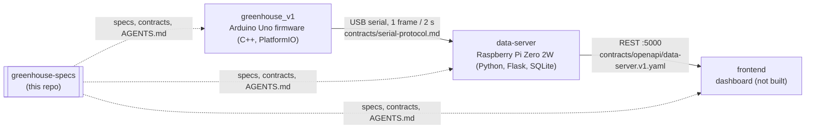

# greenhouse-specs

Specs, contracts and architecture decisions for a small smart balcony greenhouse
— and a deliberately small testbed for a **spec-first, multi-repo workflow with
coding agents**.

The code lives in sibling repos; this repo holds only what crosses repo
boundaries: the architecture, the machine-readable contracts between components,
the decisions behind them, and the conventions agents follow when they change code.

## Why a separate spec repo

Firmware and server use different toolchains and deploy paths, so they stay in
separate repos ([ADR-002](adr/ADR-002-monorepo-vs-multirepo.md)). The contracts
between them — the serial frame and the REST API — then need a home that neither
side owns. The spec repo is that home ([ADR-001](adr/ADR-001-spec-repo-pattern.md)):
all repos are cloned side by side into one workspace, the coding agent is started
on the workspace, and [`conventions/AGENTS.md`](conventions/AGENTS.md) makes it
change the contract first and the code second, and ask instead of guessing when
a spec says TBD.

## Layout

| Path | Content |
|------|---------|
| [`specs/L0-architecture.md`](specs/L0-architecture.md) | System architecture: components, hardware, cross-cutting concerns |
| [`specs/L1-services/`](specs/L1-services/) | One spec per service: responsibilities, interfaces, pin map |
| [`specs/L2-features/`](specs/L2-features/) | One spec per feature: acceptance criteria, open questions |
| [`contracts/`](contracts/) | Serial protocol and OpenAPI 3 definition of the data-server |
| [`adr/`](adr/) | Architecture decision records |
| [`conventions/AGENTS.md`](conventions/AGENTS.md) | Cross-repo rules for coding agents |
| [`glossary.md`](glossary.md) | Domain language |

The specs themselves are written in German (the project language); code,
comments and user-facing strings are English.

## Status

Early proof of concept. What exists:

- **Firmware** ([`greenhouse_v1`](https://github.com/FabianGlueck/greenhouse_v1)):
  reads three soil-moisture sensors, BME280 and BH1750, smooths the soil signal
  and streams a frame every 2 s. No automatic watering yet.
- **Data-server** (separate repo, not public): receives the serial stream,
  stores readings in SQLite, serves `/api/latest`, `/api/history`, `/api/stats`.
- **This repo**: structure, two ADRs, the serial frame documented from the
  firmware; the OpenAPI schema, the feature specs and the architecture doc are
  still partly stubs.

Next: automatic watering per compartment ([F001](specs/L2-features/F001-bewaesserung.md)),
a command channel from the Pi to the Arduino, and a dashboard
([F002](specs/L2-features/F002-dashboard.md)).
